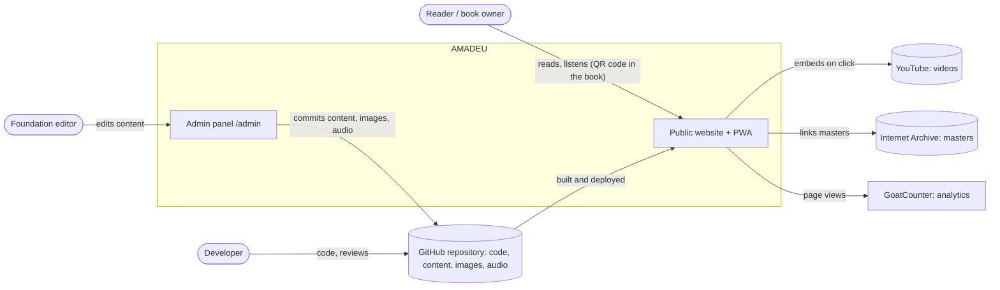
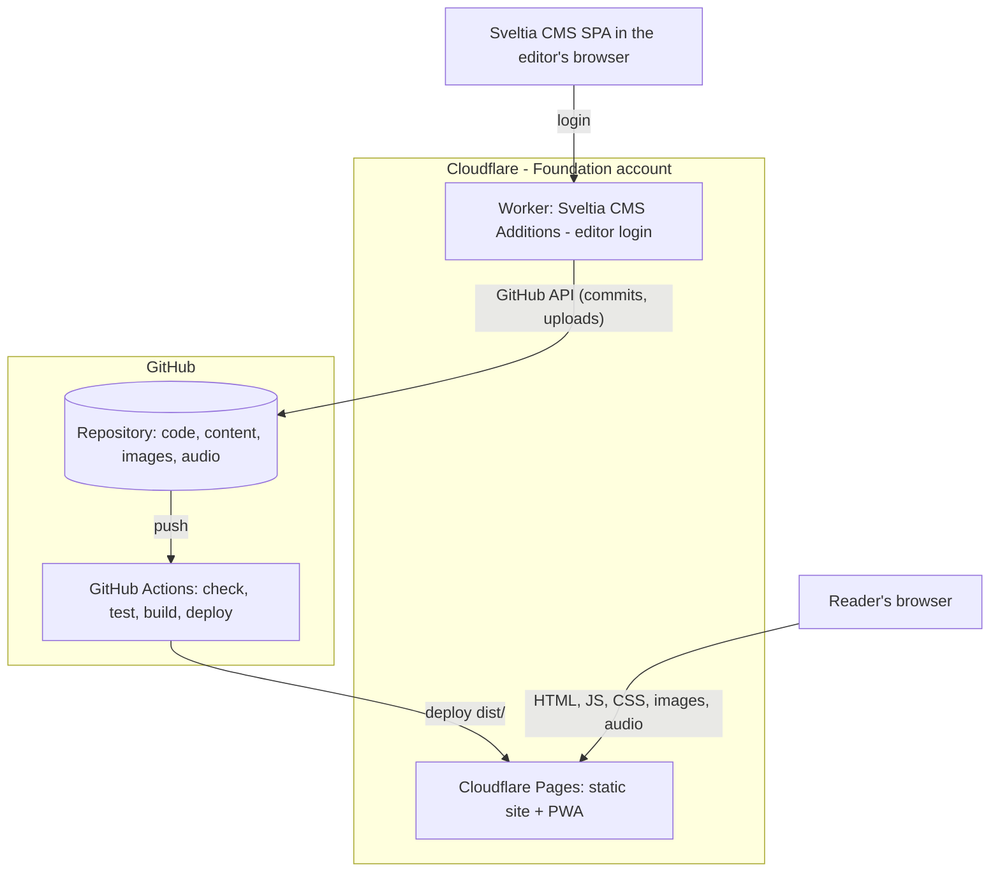
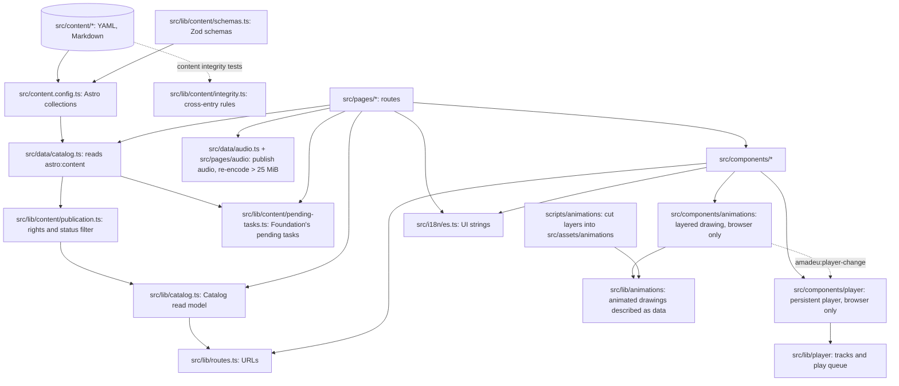
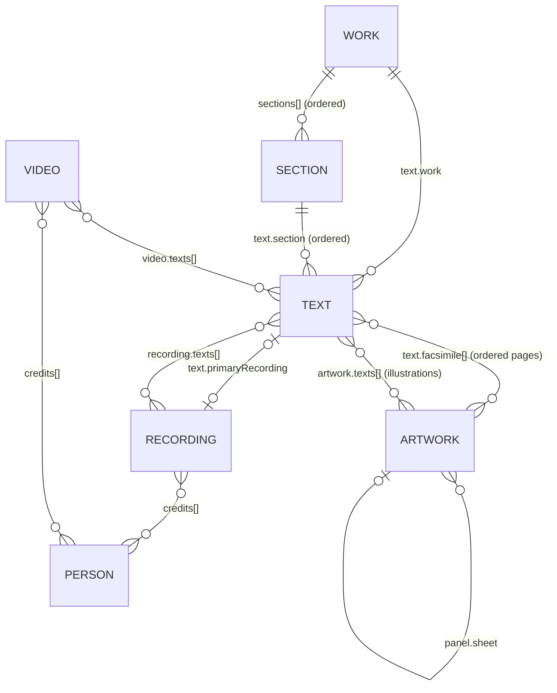
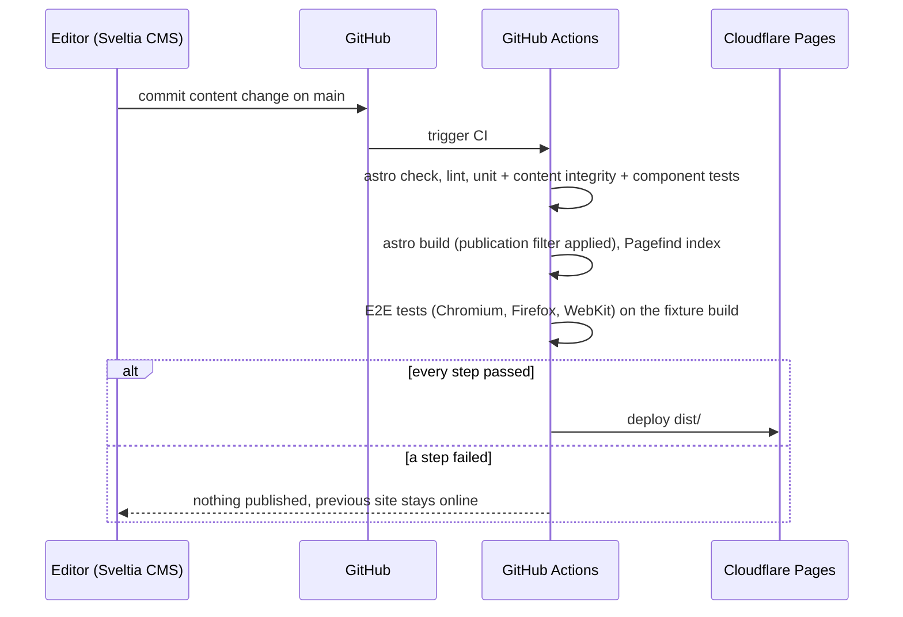
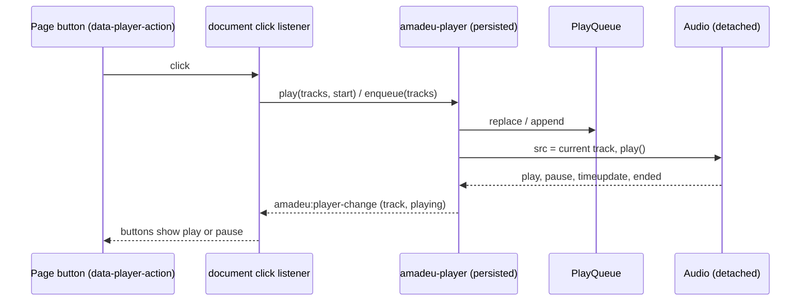

# Architecture

This document follows a reduced [arc42](https://arc42.org) template with [C4](https://c4model.com) diagrams written in Mermaid ([ADR 0043](adr/0043-architecture-documentation.md)). Requirements are in [02-technical-requirements.md](02-technical-requirements.md); the reasons behind each choice are in the [ADRs](adr/README.md).

## 1. Goals and constraints

**Goal:** a public, citable digital archive of Marcelo de Urioste's work. v1 covers *Sangre y Sueño*; more works are added later from an admin panel.

| Constraint | Consequence |
|---|---|
| Near-zero budget | Static site, free tiers only, no own servers or database |
| One developer today, possibly another tomorrow | Few moving parts, strict types, tests at four levels, documented decisions |
| Non-technical editor | Git-based CMS with a form UI; content validated before publishing |
| Heavy media (≈ 6.6 GB) and no payment card | Web-sized images and audio (≈ 500 MB) in the repository; video on YouTube; masters on Internet Archive ([ADR 0044](adr/0044-media-in-the-repository.md)) |
| Future Android app for one book | Same codebase, no server-only features |

**Quality goals, in priority order:** correctness of the archive (nothing unpublished leaks, nothing breaks silently), maintainability by a new engineer, accessibility (WCAG 2.2 AA), performance on low-end phones.

## 2. Context (C4 level 1)

## 3. Containers (C4 level 2)

| Container | Technology | Responsibility |
|---|---|---|
| Static site | Astro 7, TypeScript | Pages generated at build time from content files |
| PWA layer | `@vite-pwa/astro` (Workbox) | Install, offline texts and search |
| Admin | Sveltia CMS + Additions Worker | Form-based editing, image and audio upload into the repository |
| Content store | Markdown/YAML in `src/content/` | The archive's data ("the repository is the database") |
| Media | `src/content/media/images/`, `src/content/media/audio/` | Images (optimized by Astro at build) and audio (re-encoded at build when > 25 MiB, [ADR 0045](adr/0045-long-audio-recompressed-at-build.md)) |
| Pipeline | GitHub Actions | Quality gate and deployment |

## 4. Components (C4 level 3, the static site)

Rules that keep the code testable and replaceable:

- **`src/lib/` is framework-free.** It never imports `astro:*` modules. It holds all domain logic (publication rules, ordering, relations, URLs, integrity) and is unit-tested with ≥ 90 % coverage.
- **`src/data/catalog.ts` is the only reader of `astro:content`.** It turns collections into plain data and builds the `Catalog`.
- **Pages ask the `Catalog`; they never sort, filter or join collections themselves.**
- **Components receive plain data as props** and render it; they are tested with the Astro Container API.
- **UI text comes from `src/i18n/es.ts`**, never hard-coded.
- **Styles** are plain CSS: design tokens and base typography in `src/styles/` ([ADR 0048](adr/0048-watercolour-visual-identity.md)), everything else scoped in each component.
- **Shared page parts** are components: `SiteHeader`, `SiteFooter`, `PageBand` (the colour band that opens a page), `FramedArtwork` (an artwork in the green frame, optimized by Astro), `Verses`, `RecordingList`, `RecordFields` (the archival record), `WorkCard`, `WorkContents`, `VideoFacade` (YouTube loaded on click), `PendingTaskList`, and the player's `AudioPlayer` and `PlayerButton`.
- **Animated drawings** ([ADR 0051](adr/0051-raster-layer-animations.md)): `FramedArtwork` with `animate` shows `AnimatedDrawing` when `src/lib/animations/registry.ts` has an animation for the artwork. Its layers are files in `src/assets/animations/<artwork id>/`, cut by `scripts/animations/build.ts` from the same description.
- **Browser scripts** are plain TypeScript, without a framework: custom elements (`video-facade`, `amadeu-player`, `animated-drawing`) and document-level listeners. Their logic that can be tested without a browser lives in `src/lib/` (for example `src/lib/player/queue.ts`); the rest is covered by E2E tests.
- **Domain helpers for pages** live in `src/lib/`: `record.ts` (record fields mapped to Dublin Core), `format.ts` (dates, durations, stanzas), `youtube.ts`.

### 4.1 Content model

- An entry's **id is its file name** and never changes. Relations store ids.
- **Each relation is stored on one side only:** media point to texts; a panel points to its sheet. The `Catalog` derives the other direction, so the two sides can never disagree.
- Rights (`cleared` / `pending` / `restricted`) live on texts, recordings, artworks and videos.
- `review` (texts, recordings, artworks, videos) records what the Foundation still has to check; `notes` are permanent archival notes.
- Media live next to the content: `media/audio/` (a recording stores the file name) and `media/images/` (an artwork stores a path relative to its file, resolved by Astro's `image()`).

## 5. Runtime views

### 5.1 Build and publish

### 5.2 Publication filter

At build time, `publishedCollections()` keeps only entries that may be public (RF-57):

- works that are not `draft` (`upcoming` works only get a card);
- texts with `cleared` rights whose work is `published`;
- recordings, artworks and videos with `cleared` rights.

Relations to filtered-out entries stay in the data; the `Catalog` simply does not find them.

### 5.3 Pending tasks

`/admin/pendientes/` is built from **all** content (published or not) by `pendingTasks()` ([ADR 0046](adr/0046-pending-tasks-derived-from-content.md)). Every task is a fact about the content (a `pending` rights status, a `review` note, a song with no recording…), so the list cannot drift from the archive: correcting the entry in the admin removes the task at the next publication.

### 5.4 Audio publication

`src/pages/audio/[file].ts` is a static endpoint with one path per **published** recording. At build time it reads the file from `media/audio/` and, through `audioPublishing()`, either copies it or re-encodes it to mono 64 kbps with ffmpeg when it exceeds Cloudflare Pages' 25 MiB limit ([ADR 0045](adr/0045-long-audio-recompressed-at-build.md)).

### 5.5 Persistent player

Navigation is client-side (`<ClientRouter />`); `transition:persist` keeps the same `<amadeu-player>` element across pages, and its `Audio` object is never in the document, so nothing interrupts it ([ADR 0049](adr/0049-persistent-player-implementation.md)).

### 5.6 Permanent links

`/id/<id>/` pages are generated from `Catalog.permalinks()` as static redirect pages (`Astro.redirect` in static output produces a `meta refresh` page). This works on any static host and inside the future Android app. On Cloudflare, a `_redirects` file can be added later for an instant HTTP redirect.

## 6. Deployment

| Environment | Site | Content and media |
|---|---|---|
| Local | `npm run dev` | `src/content/` (with its `media/`) |
| E2E | `npm run build:e2e` + `astro preview` | `tests/fixtures/content/` and its fixture media |
| Prototype | `*.pages.dev` | from the repository |
| Production | Foundation domain | from the repository |

Media always ship with the site; there is no separate media host and no payment card anywhere.

## 7. Cross-cutting concepts

- **Testing** ([ADR 0040](adr/0040-testing-strategy.md)): unit (`src/lib/**/*.test.ts`), content integrity (`tests/content/`), component (`src/components/**/*.test.ts`), E2E with axe (`tests/e2e/`). Test data comes from builders (`tests/support/builders.ts`) that parse through the real schemas.
- **Accessibility:** baseline rules in `src/styles/base.css` (target size, focus), lint rules (`jsx-a11y`), automated axe checks per page.
- **i18n:** `src/i18n/es.ts`; Astro i18n routing when English is added.
- **Client-side navigation:** pages are swapped without reloading (`<ClientRouter />`). Scripts that set up a page listen to `astro:page-load`, not `DOMContentLoaded`.
- **Configuration:** environment variable `CONTENT_DIR` (see `.env.example`).

## 8. Risks and technical debt

| Item | Mitigation |
|---|---|
| iOS Safari may interrupt persistent audio | Player E2E tests run in WebKit; check on a real iPhone before launch |
| A full page reload empties the player's queue | Acceptable for v1; restore it from `sessionStorage` if needed ([ADR 0049](adr/0049-persistent-player-implementation.md)) |
| Repository grows with media (≈ 500 MB expected) | Monitor size; migrate content to its own repository via `CONTENT_DIR` if needed ([ADR 0044](adr/0044-media-in-the-repository.md)) |
| Long audio published at reduced quality (mono 64 kbps) | Known limitation; full quality kept in the repository and on Internet Archive ([ADR 0045](adr/0045-long-audio-recompressed-at-build.md)) |
| GoatCounter is maintained by one person | Migrate to Cloudflare Web Analytics if needed |
| `.astro` imports are untyped for plain TypeScript tooling | Local declaration `src/astro-modules.d.ts` (see CONTRIBUTING); logged upstream |
| Static redirect pages wait ~2 s (Astro default) | Add Cloudflare `_redirects` at deployment (H7) |
